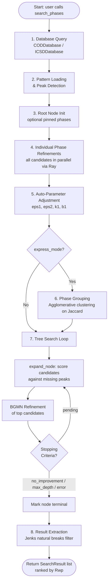

# How DARA Works — Phase Search & Automated Refinement

Source: `dara-xrd` package, CederGroup. Core files: `search/core.py`, `search/tree.py`,
`refine.py`, `structure_db.py`, `peak_matcher.py`, `cif.py`, `cif2str.py`.

---

## High-Level Flow



---

## Block-by-Block Reference

---

### Block 1 — Database Query

**Purpose:** Download or load CIF files for all candidate phases in the target chemical system.

| | |
|---|---|
| **Input** | Chemical system string e.g. `"Ge-O-Zn"`, or list of formulas; destination directory |
| **Output** | List of `.cif` file paths on disk, named `{formula}_{sg}_(cod_{id})-{e_hull}.cif` |

**Logic:**
- Reads a pre-filtered JSON index (`cod_filtered_info_2024.json.gz` or `icsd_filtered_info_2025_v3.json.gz`).
- Filters entries to the requested chemical system and all sub-systems (e.g. also fetches Fe-only and O-only phases).
- Downloads each CIF from COD server (`https://www.crystallography.net/cod/{id}.cif`) on demand; ICSD requires a local licensed copy.
- Skips phases that fail energy or gas filters (logs "Skipping …").

| Parameter | Default | Role |
|---|---|---|
| `chemsys` | — (required) | Element set to query |
| `dest_dir` | `"cifs"` | Where to save CIF files |
| `e_hull_filter` | `0.1 eV/atom` | **Tunable.** Raise to include metastable phases; lower for strict stability. |
| `exclude_gases` | `True` | Skip O2, N2, etc. |

---

### Block 2 — Pattern Loading & Peak Detection

**Purpose:** Read the experimental XRD pattern; auto-detect peaks and set angular/intensity working limits.

| | |
|---|---|
| **Input** | `pattern_path` (`.xrdml`, `.xy`, `.xye`); `wavelength`; `instrument_profile` |
| **Output** | `XRDData` object; detected peak list (2θ, intensity, width); `wmax`; `intensity_threshold`; initial `b1` estimate |

**Logic:**

1. **Peak detection** — uses a built-in peak finder on the raw diffractogram.
2. **`wmax` (angular cutoff)** — `get_optimal_max_two_theta()`: sorts peaks by 2θ, takes the 70th-percentile angle + 1° buffer. Clips the refinement range to avoid noisy high-angle region.  
   Formula: `wmax = 2θ at 70% of peaks + 1.0°`
3. **`intensity_threshold`** — `find_optimal_intensity_threshold()`: normalised cumulative intensity; threshold = intensity at 90th-percentile cumulative.  
   Also capped at `0.1 × max_intensity`.
4. **`b1` initial estimate** — mean of per-peak Gaussian width values extracted from the peak list; clamped to user-supplied bounds.

| Parameter | Default | Role |
|---|---|---|
| `wavelength` | `"Cu"` | Source radiation; `"Cu","Co","Cr","Fe","Mo"` or float in nm |
| `instrument_profile` | `"Aeris-fds-Pixcel1d-Medipix3"` | `.geq` instrument geometry file — must match your diffractometer |
| `enable_angular_cut` | `True` | **Tunable.** Set `False` to use full angular range (slower, sometimes better for low-angle phases). |
| `wmin` | `None` | Lower angular bound — set if you have a known artefact below a certain angle |

---

### Block 3 — Root Node Initialisation

**Purpose:** Create the starting point of the search tree, optionally with user-pinned (forced) phases pre-refined.

| | |
|---|---|
| **Input** | `pinned_phases` list (optional); `pattern_path`; `instrument_profile` |
| **Output** | Root `SearchNode` with `current_phases = pinned_phases`, `current_result = RefinementResult or None` |

**Logic:**
- If `pinned_phases` is empty: root node holds no result yet (Rwp = None).
- If phases are pinned: BGMN is run immediately on the pinned set; the result becomes the baseline from which all tree branches grow.

| Parameter | Default | Role |
|---|---|---|
| `pinned_phases` | `None` | **Tunable.** Force phases you know are present (e.g. substrate). Reduces search space. |

---

### Block 4 — Individual Phase Refinements (all candidates)

**Purpose:** Refine every candidate CIF independently against the pattern to get per-phase Rwp, lattice parameters, `k1`, `b1`, and `eps2` starting values before the search.

| | |
|---|---|
| **Input** | All candidate CIF paths; `phase_params`; `refinement_params`; pinned phases (added to each) |
| **Output** | Dict `{phase → RefinementResult}` for each candidate that converges; failed phases removed |

**Logic:**
- Runs `do_refinement_no_saving()` for each phase in parallel using Ray workers.
- Each call: CIF → STR (via `cif2str`) → BGMN control file → BGMN binary → parse `.lst` output.
- Phases that produce BGMN errors or negative weights are dropped.

**BGMN parameter string format:** `"initial_lower^upper"` e.g. `"0.005_0.0^0.01"` means start at 0.005, refine between 0 and 0.01. Special value `"fixed"` freezes the parameter.

| Parameter | Default | Role |
|---|---|---|
| `gewicht` | `"0_0"` | Phase weight initial & lower bound; BGMN refines this as Qphase |
| `k1` | `"0_0^0.01"` | Scale/microabsorption factor |
| `k2` | `"fixed"` | Second scale factor — keep fixed unless you have strong texture |
| `b1` | auto from block 2 | Isotropic Debye-Waller factor. **Tunable** upper bound if your phases have very broad peaks |
| `lattice_range` | `0.01` | Fractional range for a, b, c refinement (`±1%`). **Tunable** — increase to 0.03 for strained films |
| `rp` | `4` | Rietveld profile polynomial order |
| `eps1` | `0` | Zero-point offset (°2θ) — usually left at 0 |
| `eps2` | `"0_-0.05^0.05"` | Sample height/displacement (mm). **Tunable** bounds if your sample sits visibly off-centre |
| `n_threads` | `8` | BGMN internal thread count |

---

### Block 5 — Auto-Parameter Adjustment

**Purpose:** Recalculate global instrument parameters (`eps1`, `eps2`) and per-phase parameters (`k1`, `b1`) from the results of block 4 before starting the search.

| | |
|---|---|
| **Input** | All per-phase RefinementResults from block 4 |
| **Output** | Updated `refinement_params` and `phase_params` (stored in the SearchTree, applied to all subsequent refinements) |

**Logic (weighted average):**

```
weighted_eps2 = Σ[ (1/(Rwp_i + 0.1)) × EPS2_i ] / Σ[ 1/(Rwp_i + 0.1) ]
```

- Same formula applied to `eps1`.
- Better refinements (lower Rwp) receive higher weight via `1/(Rwp + 0.1)`.
- Only applied if the parameter was a refinement string (not a fixed number).
- `k1` and `b1` per-phase: updated to refined values while keeping original bounds.

No user-tunable parameters here — this block is fully automatic.

---

### Block 6 — Phase Grouping (Express Mode)

**Purpose:** Cluster structurally similar phases together so only the best representative per group enters the tree search, dramatically reducing search space.

| | |
|---|---|
| **Input** | Dict `{phase → RefinementResult}`; `distance_threshold` |
| **Output** | Dict `{phase → {group_id, fom}}` — only best-FOM phase per group is marked active |

**Logic:**

1. For every pair of phases, compute **Jaccard similarity** of their peak-angle sets (within a tolerance).  
   `distance = 1 − Jaccard_similarity`; symmetrised: `(d + dᵀ) / 2`.
2. **AgglomerativeClustering** (sklearn) with `distance_threshold=0.1` (no preset number of clusters).
3. Within each cluster, the phase with the highest **FOM** is the representative; others get status `"similar_structure"` during tree expansion.
4. After the search, all phases in a winning group are reported in `SearchResult.phases` — not just the representative.

**Figure of Merit (FOM):**
```
FOM = 1 / (rho + a×Δu + 1e-4 + c/b1) / (1 + c)
```
where `rho = Rwp`, `Δu = Σ|Δa_i/a_i| × 100` (lattice strain), `a=1, b=0, c=0` (effectively FOM ≈ 1/Rwp).

| Parameter | Default | Role |
|---|---|---|
| `express_mode` | `True` | **Tunable.** Set `False` if you have very few candidates or suspect missed groupings |
| `distance_threshold` | `0.1` | **Tunable** (internal). Lower → smaller groups, more candidates pass; higher → fewer candidates. |

---

### Block 7 — Tree Search Loop (expand_node)

**Purpose:** Incrementally build phase combinations by adding one phase at a time, guided by which candidate best explains unaccounted peaks.

This is the core DARA algorithm. Each tree node = a specific set of co-refined phases.

```
Root node (Rwp = ?)
   │
   ├─ Node: [ZnO]  (Rwp = 48.6%)
   │    ├─ Node: [ZnO, GeO2]  (Rwp = 21.3%)
   │    │    └─ Node: [ZnO, GeO2, Zn2GeO4]  (Rwp = 11.95%)  ← terminal
   │    └─ ... (pruned)
   └─ Node: [GeO2]  (Rwp = 35.4%)
        └─ ...
```

#### Sub-step 7a — Score Candidates

| | |
|---|---|
| **Input** | All single-phase RefinementResults (from block 4); current node's RefinementResult |
| **Output** | Ranked list of candidate phases above score threshold |

**Logic:**

1. Run `PeakMatcher` on the current node's result to find **missing peaks** (observed peaks not explained by current phases).
2. For each candidate phase, compute peak matching score against the missing peaks:

```
score = matched_intensity × matched_coeff
      + wrong_intensity_intensity × wrong_intensity_coeff
      + missing_intensity × missing_coeff
      + extra_intensity × extra_coeff
```
Normalised by total observed intensity.

3. Find score threshold via Savitzky-Golay second derivative of sorted scores (inflection point − 0.01 tolerance). Only candidates above threshold proceed.

| Parameter | Default | Role |
|---|---|---|
| `matched_coeff` | `1.0` | Reward for peaks the candidate explains |
| `wrong_intensity_coeff` | `1.0` | Reward even if intensity is wrong (present but misfit) |
| `missing_coeff` | `−0.01` | Penalty for observed peaks the candidate doesn't explain |
| `extra_coeff` | `−1.0` | **Tunable.** Penalty for candidate peaks with no observed match — increase magnitude to penalise spurious phases harder |

#### Sub-step 7b — BGMN Refinement of Top Candidates

| | |
|---|---|
| **Input** | Top-scored candidate phases; current node's phase set (pinned); `phase_params`; `refinement_params` |
| **Output** | `{phase → RefinementResult}` for each tested combination |

**Logic:**
- Runs `do_refinement_no_saving()` in parallel (Ray) for each candidate added to the current phase set.
- Each BGMN call: generates `.str` files from CIFs, writes a control file, runs BGMN, parses the `.lst` for Rwp, Rphase, lattice params, weights.

Same parameters as block 4 (propagated from blocks 4–5).

#### Sub-step 7c — Node Status Assignment

Each child node is labelled with a stopping reason:

| Status | Condition |
|---|---|
| `pending` | Passes all checks — will be expanded further |
| `no_improvement` | RPB did not decrease by ≥ `rpb_threshold` |
| `low_weight_fraction` | New phase has the smallest weight fraction — likely phantom |
| `similar_structure` | Not the best phase in its express-mode group |
| `max_depth` | `max_phases` limit reached |
| `error` | BGMN refinement failed |

| Parameter | Default | Role |
|---|---|---|
| `rpb_threshold` | auto (1–3) | **Most important tuning parameter.** Min RPB drop required to continue. Lower = more permissive (finds more phases, slower). |
| `max_phases` | `5` | **Tunable.** Max number of phases in any combination |

**`rpb_threshold` auto-determination:**

```
SNR (dB) of pattern → linear interpolation:
  SNR ≤ 41.6 dB  →  rpb_threshold = 3.0  (noisy data, lenient)
  SNR ≥ 52.7 dB  →  rpb_threshold = 1.0  (clean data, strict)
```

---

### Block 8 — Result Extraction & Ranking

**Purpose:** Collect terminal nodes, remove statistical outliers, return ranked solutions.

| | |
|---|---|
| **Input** | Full search tree (all expanded nodes) |
| **Output** | `list[SearchResult]` sorted by Rwp ascending (best first) |

**Logic:**

1. Collect all leaf nodes with status `"expanded"` or `"max_depth"`.
2. **Jenks natural breaks filter**: iteratively splits Rwp values into two classes; removes the high-Rwp class if its minimum exceeds the low-Rwp class maximum by > 5%. Repeats until no outliers remain.
3. In express mode: expand each winning phase back to all members of its group (the alternative CIFs that were clustered together in block 6) — these appear as `SearchResult.phases[i]` tuples.
4. Return `SearchResult` objects containing: `refinement_result` (full BGMN output), `phases` (all alternatives per slot), `foms`, `lattice_strains`, `missing_peaks`, `extra_peaks`.

---

## Parameter Quick-Reference

### Must-set per run

| Parameter | Where | What to provide |
|---|---|---|
| `pattern_path` | `search_phases()` | Path to your `.xy` / `.xrdml` file |
| `phases` | `search_phases()` | List of CIF paths (output of block 1, or your own) |
| `wavelength` | `search_phases()` | `"Cu"`, `"Co"`, `"Mo"`, etc. |
| `instrument_profile` | `search_phases()` | Name of `.geq` file matching your diffractometer |
| `chemical_system` | `CODDatabase` query | Element set, e.g. `"Li-Ni-Mn-Co-O"` |

### Key tuning parameters

| Parameter | Default | When to change |
|---|---|---|
| `rpb_threshold` | auto 1–3 | Lower (e.g. 0.5) if you expect many minor phases; raise (e.g. 4) if speed matters |
| `max_phases` | `5` | Increase if you know > 5 phases are present |
| `e_hull_filter` | `0.1 eV` | Increase to 0.2–0.3 for metastable/doped phases, decrease to 0.05 for well-known systems |
| `express_mode` | `True` | Set `False` if you have < 10 candidates or want exhaustive search |
| `enable_angular_cut` | `True` | Set `False` if important peaks are at high angle |
| `lattice_range` | `0.01` | Increase to 0.03 for strained thin films or non-equilibrium samples |
| `eps2` bounds | `−0.05^0.05` | Widen if sample loading is inconsistent; tighten for a well-set goniometer |
| `pinned_phases` | None | Set to substrate or known phase to remove it from the unknowns |
| `extra_coeff` | `−1.0` | Make more negative (e.g. `−2.0`) to penalise phantom phases harder |
| `n_threads` | `8` | Set to number of physical cores on your machine |

---

## What BGMN Refines Inside Each Node

For each phase, BGMN simultaneously varies:

- `a, b, c, α, β, γ` — lattice parameters (within `±lattice_range`)
- `k1` — scale / micro-absorption correction
- `b1` — isotropic Debye-Waller factor
- `GEWICHT` (Qphase) — phase weight fraction
- Globally: `EPS1` (zero point), `EPS2` (sample height)

Atomic positions are **not** refined during the search — they stay fixed at CIF values. The search only determines which phases are present; positional refinement is left to the full Rietveld step (GSAS-II, Level 2).

---

## Output of `search_phases`

Each `SearchResult` contains:

| Field | Content |
|---|---|
| `refinement_result.lst_data.rwp` | Final Rwp (%) |
| `refinement_result.lst_data.phases_results` | Per-phase: Rphase, lattice params (± σ), GEWICHT (weight fraction ± σ), k1, b1 |
| `phases` | Tuple of tuples — alternative CIFs for each phase slot |
| `foms` | Figure of merit per phase slot |
| `lattice_strains` | Fractional lattice deviation from CIF reference |
| `missing_peaks` | [2θ, intensity] of peaks not explained by solution |
| `extra_peaks` | [2θ, intensity] of calculated peaks with no observed match |
| `.visualize()` | Interactive plot of fit, residual, missing/extra peaks |
